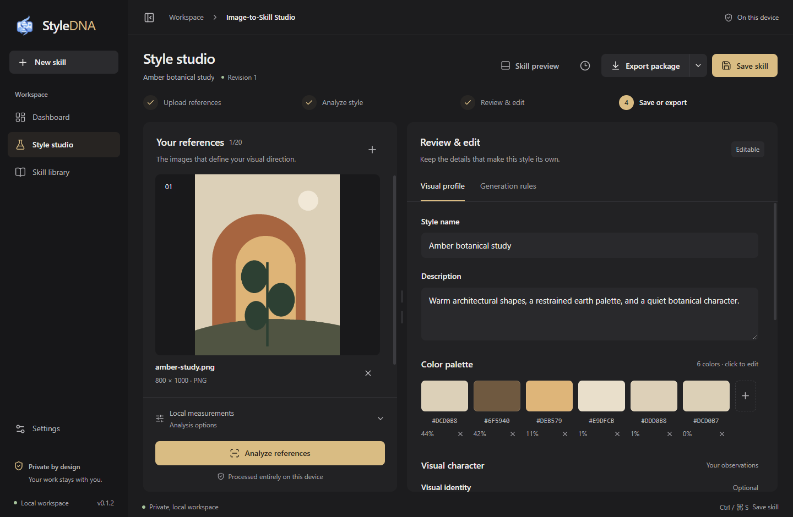

# StyleDNA


**Turn Images Into Reusable AI Style Skills.**

StyleDNA is a local-first desktop workspace for collecting visual references, analyzing their style, and generating reusable **`SKILL.md` files**. It pairs a Tauri 2 / React interface with a Python image-processing service and a versioned SQLite library.

Its output is reusable **`SKILL.md` files and style profiles**. The workflow is **upload references → analyze style → review and edit → save or export skills**. See [product scope](docs/PRODUCT_SCOPE.md).

## What StyleDNA does

- Import PNG, JPEG, and WebP references with content validation, normalized copies, and thumbnails.
- Measure real palettes, luminance, saturation, contrast, edges, and texture without an AI model.
- Optionally interpret visual traits with an installed **local Ollama vision model**. Results are validated suggestions; failures never fall back to invented output.
- Edit the palette, visual traits, positive rules, negative constraints, and subject exclusions.
- Save, search, categorize, tag, favorite, duplicate, delete, and restore saved skill revisions.
- Preview/copy deterministic `SKILL.md` content; export Markdown, JSON, or portable ZIP packages; import packages under new identities.
- Dark/light themes, drag-and-drop import, keyboard navigation, progress/cancellation, and unsaved-change navigation protection.
- A comfortable, spacious studio with adjustable reference/editor panels, a collapsible Markdown preview, grouped sidebar navigation, and expandable advanced controls.

The roadmap focuses on style extraction, multi-reference analysis, skill authoring, compatibility, and desktop reliability. In-app image synthesis and generated-image history are outside the product scope. Exported style instructions are guidance for compatible AI tools and cannot guarantee exact visual reproduction.

## Quick start

Development requires Node.js 24 LTS, pnpm 12.21.0, Python 3.12, and [uv](https://docs.astral.sh/uv/). Desktop builds also require Rust 1.90+ and the [Tauri platform prerequisites](https://v2.tauri.app/start/prerequisites/).

```sh
corepack pnpm install --frozen-lockfile
uv sync --locked
corepack pnpm dev
```

Open **http://127.0.0.1:1420**. This starts the real backend and frontend together, stores development data in `.styledna-dev/`, and stops the backend when the launcher exits. Running `dev:web` alone only starts Vite; it does not start a backend.

In Windows PowerShell, use `corepack.cmd` in place of `corepack` if script execution policy blocks the PowerShell shim. No execution-policy change is needed.

For the desktop application:

```sh
corepack pnpm build:sidecar
corepack pnpm desktop
```

The sidecar packages Python and its runtime libraries. Installed-app users do **not** need Python, Node, or uv. Development does. Rebuild the sidecar after Python changes when testing the desktop host.



Actual Windows desktop workspace using the included, manually authored example reference.

## Try a reference

Create a new skill and import [`examples/amber-study.png`](examples/amber-study.png). Choose **Local measurements**, analyze, apply the result, and add your own visual traits. Save, then export a package.

Alternatively, import [`examples/amber-study.zip`](examples/amber-study.zip) from the library. This example is a synthetic, manually authored illustration and profile licensed under MIT; it is not presented as AI output. Nothing is auto-added to your library.

## Optional local AI

Install [Ollama](https://ollama.com/) and a compatible vision model separately. Start Ollama, open **Settings & Providers**, save/check its loopback address, and select a model reporting vision support. In the studio choose **Ollama vision** and start analysis. Model discovery never downloads or runs a model automatically. Cloud-routed Ollama models are excluded.

Local measurements extract numeric evidence. They intentionally leave semantic style fields unassessed. Human edits remain useful with no model installed. Ollama interpretations require review and are not calibrated confidence scores. Multiple references currently have equal influence.

## Checks

```sh
uv run pytest -q
uv run ruff check backend scripts
uv run ruff format --check backend scripts
corepack pnpm test
corepack pnpm build
corepack pnpm format:check
corepack pnpm exec playwright install chromium
corepack pnpm test:e2e
```

Native checks require the sidecar first:

```sh
corepack pnpm build:sidecar
cargo check --manifest-path src-tauri/Cargo.toml
cargo test --manifest-path src-tauri/Cargo.toml
corepack pnpm build:desktop
```

See [verification status](docs/VERIFICATION.md) for commands actually run on the development host. Workflow configuration is not proof of tested platform support. Cross-platform packaging is configured, with platform results documented separately. No releases are published automatically.

## Privacy and data

There is no telemetry, account requirement, or automatic image upload. Measurement analysis stays inside the application. Ollama analysis sends bounded reference previews to your selected loopback service only when you start it. Exports contain metadata-stripped reference copies; your originals are never modified.

The desktop app stores its database and assets under the OS application-data directory for `com.styledna.desktop`. Settings displays the exact path. Development uses `.styledna-dev/` unless `STYLEDNA_DATA_DIR` is set. Portable packages are the supported per-skill backup mechanism. Quit before backing up an entire data directory; include SQLite WAL files if present.

The authenticated local service binds an ephemeral loopback port. The desktop host owns its process. Credentials are per-launch and are not persisted. The current app has no cloud-provider API keys. See [SECURITY.md](SECURITY.md) and [architecture](docs/ARCHITECTURE.md).

## Limits and compatibility

20 references per skill; 20 MiB encoded input and normalized reference limit; 40 megapixels decoded per image; 200 MiB combined image upload; 250 MiB expanded package; 5 GiB managed-asset storage. Saving also enforces a package budget with metadata overhead so a skill remains portable. Animated images are rejected. Inference previews are bounded to 2,048 pixels and thumbnails to 320 pixels. Limits live in `backend/styledna/config.py`.

`SKILL.md` uses a conservative name/description frontmatter and relative reference links. The package is portable data, not an executable plugin. Agent-specific installation/loading and generator compatibility have not been certified; review the target agent's current skill conventions before installation. Markdown/JSON exports alone do not contain the reference assets; use ZIP for a self-contained package.

MIT licensed. Contributions welcome: [CONTRIBUTING.md](CONTRIBUTING.md).
