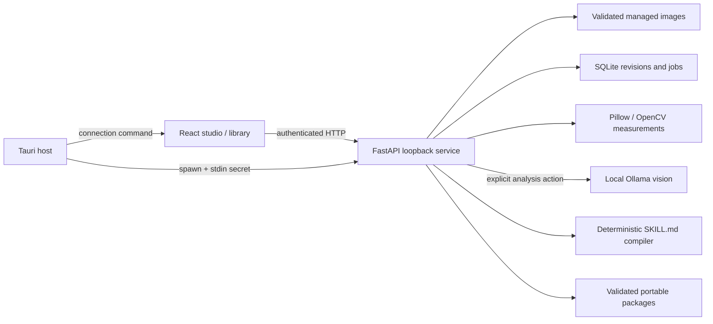

# Architecture

The React workspace owns an editable draft. Python owns durable data and analysis. Rust owns the desktop service lifecycle and native save dialogs.

## Modules and contracts

`models.py` contains bounded schema-v1 profiles and provenance. `assets.py` decodes real image content, normalizes orientation/colors, strips metadata, and creates bounded previews/thumbnails. `analysis.py` measures numeric evidence, with equally weighted per-reference palettes. These measurements do not assign semantic labels.

`ollama.py` checks installed model capabilities and validates schema-constrained responses. It retains individual observations before multi-reference synthesis. `jobs.py` bounds work, persists states, supports cancellation, and never saves a profile. The editor rejects analysis for changed references and preserves manual semantic edits.

`database.py` uses explicit SQLite migrations, WAL, foreign keys, indexed library filters, immutable revisions, expected-revision conflict protection, and reference-aware asset cleanup. The initial migration is idempotent; future schema changes must add explicit migrations. Revision restoration appends a revision. Duplicate skills share immutable managed assets; deletion retains assets referenced by another skill or an older revision.

`compiler.py` renders stable Markdown from validated profile data, escaping frontmatter and Markdown text. `packages.py` owns package schema and archive validation. `app.py` defines the authenticated routes and ASGI size/origin/host boundary. `__main__.py` binds an ephemeral loopback socket, announces readiness after startup, and exits when its parent closes stdin.

React pages are lazy loaded. Blob previews use authorization headers and reference-counted object URLs instead of bearer tokens in URLs. Library pages are bounded to 24 items (API maximum 48), avoiding loading all image assets. Job polling is bounded and stops on terminal states/unmount. A studio draft is separate from saved revision content; exports require a saved revision.

The studio uses an adjustable reference/editor split and an optional bottom Markdown panel. Advanced traits, metadata, measurements, and analysis options expand when needed. At narrow widths panels stack, and the sidebar becomes a compact rail or drawer. Resizers support pointer and keyboard input; UI layout preferences contain no project data. Save responses reconcile against the submitted snapshot rather than replacing later edits. Opening a skill is owned by a navigation operation, and later navigation invalidates stale responses. Discard restores the in-memory saved snapshot without requiring a functioning service.

## Portable package v1

`manifest.json` contains `package_version: 1`, `profile_version: 1`, and an asset listing with safe generated IDs, relative PNG paths, SHA-256 hashes, and original display filenames. `style.json` is a schema-v1 profile. `SKILL.md` is the deterministic compiler output for that revision. `references/<asset-id>.png` holds normalized, metadata-stripped reference copies.

Imports validate archive metadata and checksums, then pass every image through the standard decoder. They allocate fresh image/skill identities and remap analysis reference IDs. The imported Markdown is never authoritative and is recompiled. Errors remove new assets and never create a visible partial skill. Neither ZIP paths nor embedded instructions are executed or fetched.

Saves bound aggregate reference bytes plus serialized metadata and reserved archive overhead to the portable-package budget. Export rechecks existing revisions and encoded ZIP size so the application never produces a package its size policy rejects on reimport.

## Lifecycle and resource limits

Image decoding has two slots; analysis has one running worker and up to four active/queued jobs. Images are sampled at bounded resolution for measurements. GPU work belongs to Ollama; a completed request asks it not to keep the model loaded. Cancellation closes StyleDNA's request and prevents a result from being applied, but cannot guarantee another service has released resources immediately.

Startup marks unfinished jobs interrupted, clears abandoned staging directories, and removes orphan imports older than one day. Recent unsaved assets are retained briefly; unsaved profile text itself is not persisted across an application restart. App-data storage is plaintext and owned by the OS user.

Native window-close handling is registered by the frontend after its listener is ready. That readiness is separate from service availability, so a service failure does not bypass the unsaved-draft guard. Before the UI is ready, the native startup fallback can still close the window. `STYLEDNA_DATA_DIR` can override the desktop data directory for isolated verification.

## Extension points

Extend image analysis through explicit capability contracts and validated schemas. Further work should improve recurring-style extraction, multi-reference synthesis, profile editing, skill compilation, portable packages, and verified agent-format compatibility. Providers analyze references; image synthesis and generated-image history are outside this application's scope. Any future authenticated analysis provider requires explicit upload UI and OS credential storage. No cloud credential settings are exposed yet. See `PRODUCT_SCOPE.md`.
